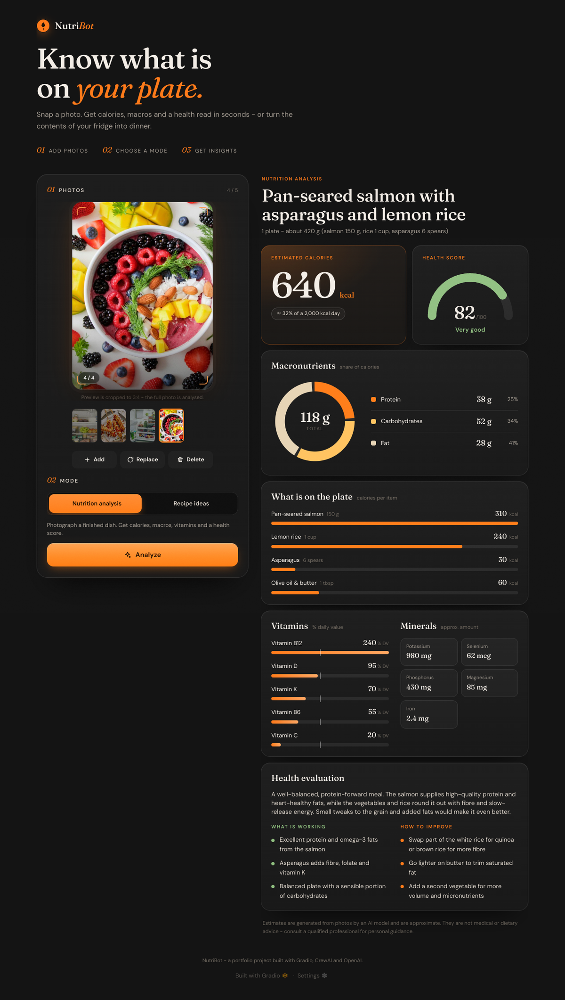
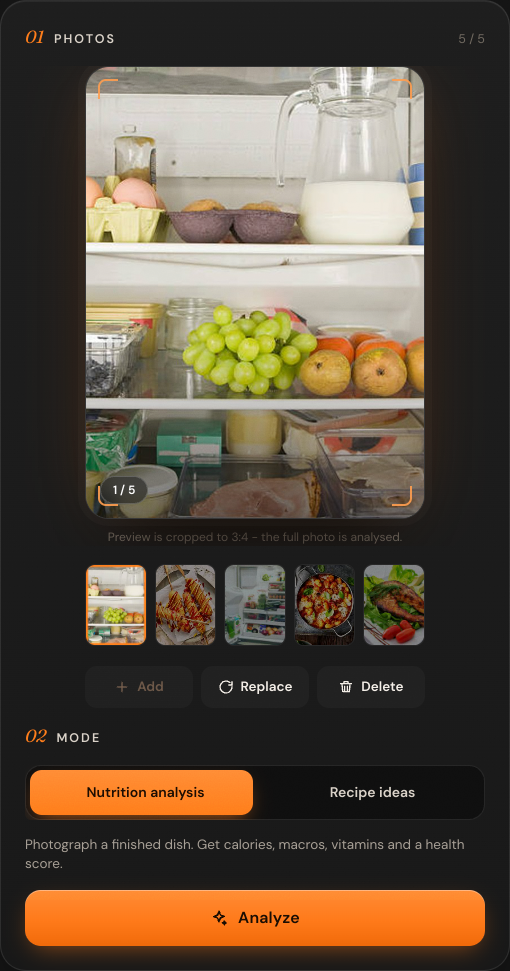
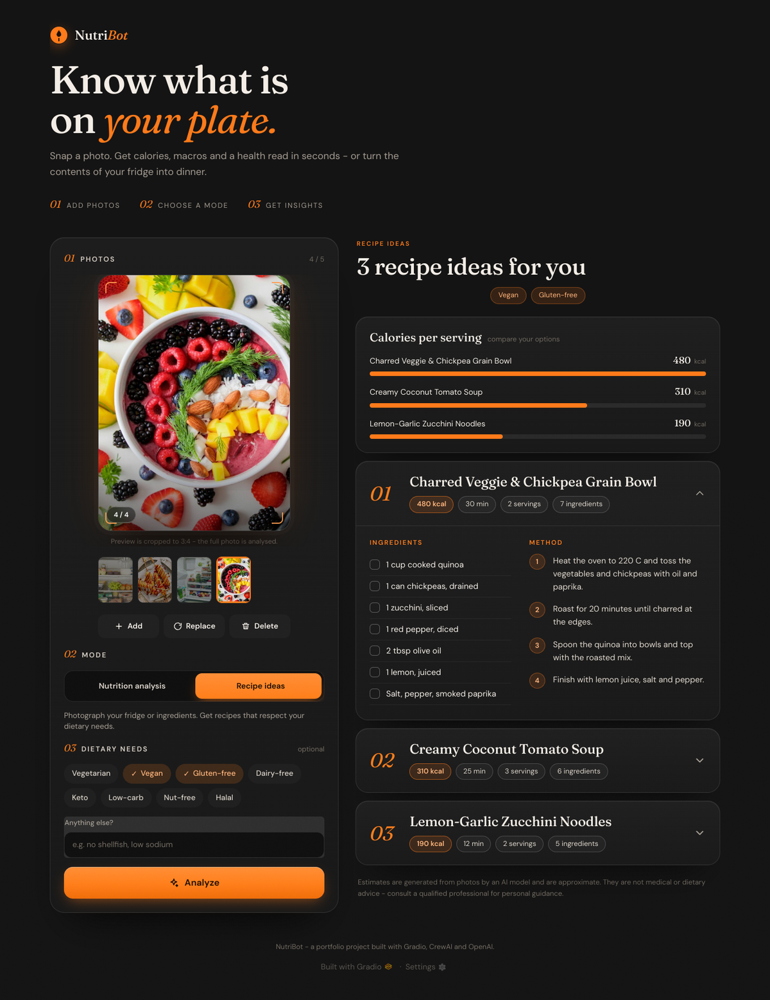

# NutriBot 🥗

A smart dietary assistant. Upload up to five food photos and NutriBot either **analyses the meal** (calories, macros, vitamins, minerals, health score) or **suggests recipes** from the ingredients it sees, filtered by your dietary needs.

Built with **Gradio**, **CrewAI** and the **OpenAI API**.

<p align="center">
  
</p>

<p align="center">
  
  &nbsp;&nbsp;
  
</p>

## Features

- **Multi-photo portrait uploader** - up to 5 photos, fixed 3:4 portrait preview, thumbnail strip, and **Add / Replace / Delete** controls.
- **Nutrition analysis mode** - animated calorie hero, macro donut, per-item calorie bars, vitamin %DV bars, mineral chips, a 0-100 health score and "what's working / how to improve" lists.
- **Recipe mode** - 3-4 recipe cards with calories, time, servings, a checkable ingredient list and numbered method. Diet chips (vegan, gluten-free, keto...) plus a free-text field.
- **Real progress** - recipe mode shows which agent task is running (detect → filter → create).
- **Dark, grainy-charcoal + orange design system** - serif display type (Fraunces), responsive down to phone width, reduced-motion friendly.
- **Robust output handling** - tolerant parser for the model's loosely-typed output, HTML-escaped rendering, friendly error cards.

## How it works

```
Photos ─► ui/uploader.py (validate, 3:4 preview) ─► per-request temp JPEGs
        └► app.py ─► CrewAI crews (src/crew.py) ─► OpenAI vision + text models (src/tools.py)
                                   └► structured JSON (src/models.py) ─► ui/parsing.py ─► ui/components.py + ui/charts.py ─► gr.HTML
```

| Path | Purpose |
|---|---|
| `app.py` | Gradio layout, event wiring, run loop |
| `src/` | CrewAI agents, tasks, OpenAI-backed tools, Pydantic output schemas |
| `ui/theme.py`, `ui/styles.css` | Theme tokens, grain texture, all component styles |
| `ui/uploader.py` | Pure-Pillow logic for the 5-photo uploader (no Gradio import) |
| `ui/parsing.py` | Turns raw model output into typed view models |
| `ui/charts.py`, `ui/components.py` | Inline SVG/HTML renderers |
| `ui/demo_data.py` | Sample outputs for demo mode and tests |
| `tests/` | Unit tests for the uploader, parser, renderers and tools |

## Getting started

Requires Python 3.11+ and an OpenAI API key.

```bash
git clone https://github.com/punyatoya-github/NutriBot.git
cd NutriBot
python -m venv venv && source venv/bin/activate   # Windows: venv\Scripts\activate
pip install -r requirements.txt
cp .env.example .env                              # then add your OPENAI_API_KEY
python app.py                                     # http://127.0.0.1:5000
```

### Try the UI without an API key

```bash
NUTRIBOT_DEMO=1 python app.py
```

Demo mode returns canned results, so you can explore the whole interface offline.

### Configuration

| Variable | Default | Meaning |
|---|---|---|
| `OPENAI_API_KEY` | - | Required for real runs |
| `NUTRIBOT_VISION_MODEL` | `gpt-4.1-mini` | Multimodal model for photo analysis |
| `NUTRIBOT_TEXT_MODEL` | `gpt-4o-mini` | Text model for the agents and diet filter |
| `NUTRIBOT_TIMEOUT` | `300` | Seconds before a run times out |
| `PORT` | `5000` | Server port |
| `NUTRIBOT_DEMO` | off | `1` = canned sample results |

## Usage

1. **Add photos** (up to 5). Click a thumbnail to preview it; use **Add**, **Replace** or **Delete** to manage them.
2. **Choose a mode**: *Nutrition analysis* (a finished dish) or *Recipe ideas* (your fridge or ingredients).
3. In recipe mode, pick **dietary needs** (optional).
4. Press **Analyze**.

When several photos are added, nutrition mode treats them as one meal and recipe mode merges the ingredients it finds across all of them.

## Tests

```bash
pip install pytest
python -m pytest tests -q
```

## Notes

- Estimates come from an AI model looking at photos. They are approximate and are **not medical or dietary advice**.
- Uploaded photos are sent to OpenAI for analysis. Temporary copies made for each request are deleted afterwards, and Gradio's upload cache is purged after six hours.
- The Google Fonts stylesheet (Fraunces, DM Sans) is loaded from Google; the UI falls back to system serif/sans fonts if it is unavailable.

## **Authors 👩‍💻**

* Punyatoya Mohanty

## **License 📜**

This project is licensed under the MIT License.
